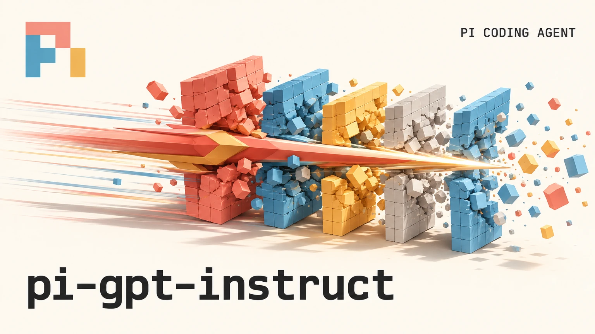

[简体中文](README.md) | **English**



# pi-gpt-instruct

A jailbreak extension for GPT models in PI Coding.

## Installation & Quick Start

**Requirements**: Pi Coding Agent, `git`, `python3` (Linux and macOS; Windows users are recommended to run inside WSL).

```bash
pi install git:github.com/TATnvn/pi-gpt-instruct
```

Run `/reload` in an active Pi session to load the extension. Once loaded, enable it and check its status in the current session:

```text
/gpt-instruct on
/gpt-instruct status
```

To enable it by default across all sessions without explicit session-level settings, configure the global default:

```text
/gpt-instruct default on
```

## Commands & Toggle Rules

After installation, the extension is globally disabled (`off`) by default. All toggle changes take effect at the **start of the next turn**.

| Command | Scope | Description |
|---|---|---|
| `/gpt-instruct on` | Current session | Enable prompt replacement in the current session (overrides global default) |
| `/gpt-instruct off` | Current session | Disable prompt replacement in the current session (overrides global default) |
| `/gpt-instruct reset` | Current session | Clear session-specific override and revert to the global default |
| `/gpt-instruct default on` | Global | Enable by default from the next turn for sessions without an override |
| `/gpt-instruct default off` | Global | Set global default to disabled |
| `/gpt-instruct status` | - | View global status, current session settings, and matched prompt file (equivalent to `/gpt-instruct`) |
| `/gpt-instruct update` | - | Bypass the check interval and immediately force-sync the latest prompts from upstream |

## Prompt Matching & Updates

### Model Matching

When the extension is enabled and a matching prompt file exists locally, its contents replace the turn's system prompt. Matching is case-insensitive and based on the current model ID prefix, favoring the longest match:

| Model ID Example | Matched Prompt File | Description |
|---|---|---|
| `gpt-5.6-sol` | `gpt-5.6-sol.md` | Supports models with date suffixes (e.g. `gpt-5.6-sol-20261101`); generates a generalized `gpt-5.6.md` alias during sync |
| `gpt-6-astra` | `gpt-6-astra.md` | Supports prefix matching for models with suffixes |
| `gpt-6.1-sol` | `gpt-6.1-sol.md` | Supports prefix matching for models with suffixes |

Local prompt files are stored in `~/.pi/agent/prompt-files/`. You can also add custom Markdown prompt files here. If an upstream release adds a file with the same name later, automatic sync will overwrite the local file.

### Sync & Backups

The extension checks for upstream releases on demand at Pi startup and at the beginning of each turn, with a default 6-hour interval after a successful check. If the network is unavailable, it continues using existing local files. Each model line automatically syncs the highest release version (including RC pre-releases). Existing prompt files are automatically backed up to `~/.pi/agent/gpt-instruct-backups/` before any update.

## Acknowledgments & License

- Licensed under the MIT License.
- Prompt designs originate from the open-source project [MDX-Tom/gpt-instruct](https://github.com/MDX-Tom/gpt-instruct) (original authors: li lingbo, yynxxxxx, and community contributors).
